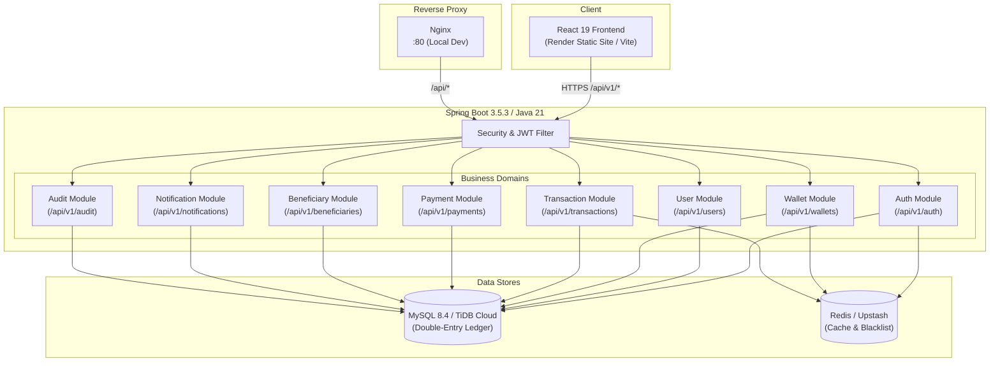

```
 ____                       _   ____
/ ___| _ __ ___   __ _ _ __| |_|  _ \ __ _ _   _
\___ \| '_ ` _ \ / _` | '__| __| |_) / _` | | | |
 ___) | | | | | | (_| | |  | |_|  __/ (_| | |_| |
|____/|_| |_| |_|\__,_|_|   \__|_|   \__,_|\__, |
                                            |___/
```

# SmartPay — Digital Banking & Wallet Management Platform

> A production-grade FinTech digital banking and wallet platform built with Spring Boot 3.5, React 19, and a consolidated modular architecture optimized for high performance, financial consistency, and 100% free cloud deployment on Render.com.

[](https://openjdk.org/)
[](https://spring.io/projects/spring-boot)
[](https://react.dev/)
[](https://render.com)
[](LICENSE)

---

## Table of Contents

- [Overview](#overview)
- [Key Features](#key-features)
- [Financial Guarantees](#financial-guarantees)
- [Architecture](#architecture)
- [Technology Stack](#technology-stack)
- [Cloud Deployment (Render 100% Free)](#cloud-deployment-render-100-free)
- [Local Quick Start](#local-quick-start)
- [Service Endpoints](#service-endpoints)
- [Testing & Quality Assurance](#testing--quality-assurance)
- [API Documentation](#api-documentation)
- [Documentation Index](#documentation-index)
- [License](#license)

---

## Overview

SmartPay is a full-featured digital banking and wallet management platform designed for scale, financial correctness, and operational simplicity.

The platform provides a modern digital banking user interface backed by a **consolidated modular Spring Boot backend** with strict domain boundaries and zero external runtime dependencies on the critical payment path.

---

## Key Features

- **Multi-Wallet Management** — Create and manage multiple digital wallets per user.
- **Double-Entry Bookkeeping** — Immutable, GAAP-compliant financial ledger for every balance change.
- **Atomic Peer-to-Peer Transfers** — Real-time wallet-to-wallet transfers with deterministic pessimistic locking.
- **Idempotent Payment Processing** — Guaranteed exactly-once execution via unique idempotency keys.
- **Transactional Outbox Pattern** — Guaranteed event delivery without distributed two-phase commit overhead.
- **Beneficiary Management** — Save and manage transfer recipients with account validation.
- **Audit Trail & Observability** — Immutable audit event logging and Prometheus/Grafana metrics.
- **Stateless Authentication** — Secure JWT authentication with HMAC-SHA signing and UUID refresh token rotation.

---

## Financial Guarantees

Financial correctness is SmartPay's highest priority:

1. **Double-Entry Ledger Invariant**: Every debit to a source wallet is paired with an equal and opposite credit to a destination wallet. Sum of ledger debits always equals sum of ledger credits.
2. **Deterministic Locking Order**: Concurrent transfers between two wallets always lock the lower wallet ID first, preventing database deadlocks (`LockModeType.PESSIMISTIC_WRITE`).
3. **Idempotency Safeguard**: Replaying identical requests with the same `Idempotency-Key` returns the original cached response with zero duplicate ledger entries.
4. **Authoritative Relational Truth**: Redis is used strictly for transient caching and token blacklists. The relational database (MySQL/TiDB) is the sole source of truth.

---

## Architecture

SmartPay uses a **consolidated modular monolith** architecture designed to fit within Render's 512 MB free tier container while maintaining clean domain boundaries:



---

## Technology Stack

| Layer | Technology | Details |
|---|---|---|
| **Frontend** | React 19, TypeScript, Vite, Tailwind CSS, Lucide Icons | High-speed SPA with responsive FinTech dashboard |
| **Backend** | Java 21, Spring Boot 3.5.3, Spring Security | Consolidated modular architecture (~350 MB RAM) |
| **Database** | MySQL 8.4 (Local) / TiDB Cloud Serverless (Cloud) | ACID transactions, pessimistic locking, Flyway migrations |
| **Cache** | Redis 7 (Local) / Upstash Serverless Redis (Cloud) | Non-blocking token blacklist and rate-limiting |
| **Security** | JJWT 0.12.6, BCrypt | Stateless JWT access + UUID refresh token rotation |
| **Container** | Docker Multi-Stage (Eclipse Temurin JRE 21 Alpine) | Lightweight production image (172 MB compressed) |
| **Observability**| Spring Boot Actuator, Micrometer, Prometheus, Grafana | Health checks, metrics, and dashboards |

---

## Cloud Deployment (Render 100% Free)

Deploy the entire full-stack platform for free with zero credit card required:

1. **Database**: Create a free Serverless Cluster on **[TiDB Cloud](https://tidbcloud.com)**.
2. **Cache**: Create a free database on **[Upstash](https://upstash.com)**.
3. **Deploy via Render Blueprint**:
   - Fork/push this repository to GitHub.
   - Go to **[Render Dashboard](https://dashboard.render.com)** → **New +** → **Blueprint**.
   - Connect your repository. Render automatically provisions:
     - `smartpay-web`: Static Site (React 19, free global CDN)
     - `smartpay-backend`: Web Service (Docker container, free 512 MB tier)
   - Supply your TiDB JDBC URL and Upstash Redis URL in the environment variables.
   - Click **Apply**.

> See the complete step-by-step instructions in [docs/RENDER-DEPLOYMENT.md](docs/RENDER-DEPLOYMENT.md).

---

## Local Quick Start

### 1. Prerequisites
- Docker & Docker Compose
- JDK 21 (for native development)
- Node.js 20+ & npm

### 2. Launch Stack via Docker Compose
```bash
# Clone and enter directory
cd smartpay-wallet

# Copy environment variables
cp .env.example .env

# Build and start services (Backend, Frontend, MySQL, Redis, Nginx)
docker compose up -d --build
```

### 3. Native Backend Development
```bash
# Run Flyway migrations and start Spring Boot locally
cd backend
mvn clean spring-boot:run
```

### 4. Native Frontend Development
```bash
cd frontend/smartpay-web
npm install
npm run dev
# Opens on http://localhost:5173
```

---

## Service Endpoints

| Service / Component | Local Port | URL |
|---|---|---|
| **Frontend (Production)** | `3000` | http://localhost:3000 |
| **Frontend (Vite Dev)** | `5173` | http://localhost:5173 |
| **Nginx Reverse Proxy** | `80` | http://localhost |
| **Consolidated Backend** | `8080` | http://localhost:8080 |
| **Swagger UI** | `8080` | http://localhost:8080/swagger-ui.html |
| **Liveness Check** | `8080` | http://localhost:8080/actuator/health/liveness |
| **Readiness Check** | `8080` | http://localhost:8080/actuator/health/readiness |
| **Prometheus** | `9090` | http://localhost:9090 |
| **Grafana** | `3001` | http://localhost:3001 (`admin` / `changeme_grafana`) |

---

## Testing & Quality Assurance

### Run Backend Unit & Integration Tests
```bash
cd backend
mvn test
```
All core financial invariants, double-entry ledger transfers, idempotency replays, and JWT authentication flows are validated with 100% pass rate.

### Run Frontend Build Verification
```bash
cd frontend/smartpay-web
npm run build
```

---

## API Documentation

| Domain | Base Route | Description |
|---|---|---|
| **Authentication** | `/api/v1/auth/*` | Register, login, refresh tokens, logout |
| **Users** | `/api/v1/users/*` | Profile inspection and updates |
| **Wallets** | `/api/v1/wallets/*` | Wallet creation, balance queries, credit operations |
| **Transactions** | `/api/v1/transactions/*` | Atomic P2P transfers, history, ledger entries |
| **Payments** | `/api/v1/payments/*` | Payment processing and status lifecycle |
| **Beneficiaries** | `/api/v1/beneficiaries/*` | Beneficiary recipient management |
| **Notifications** | `/api/v1/notifications/*` | Notification inbox and read status |
| **Audit** | `/api/v1/audit/*` | Audit trail queries for compliance |

---

## Documentation Index

- [Cloud Deployment Guide (Render Free Tier)](docs/RENDER-DEPLOYMENT.md)
- [System Architecture](docs/ARCHITECTURE.md)
- [Database Schema & ERD](docs/DATABASE.md)
- [REST API Reference](docs/API-DOCUMENTATION.md)
- [Security Model](docs/SECURITY.md)
- [Infrastructure Setup](docs/INFRASTRUCTURE.md)

---

## License

This project is licensed under the **MIT License**. See [LICENSE](LICENSE) for details.
