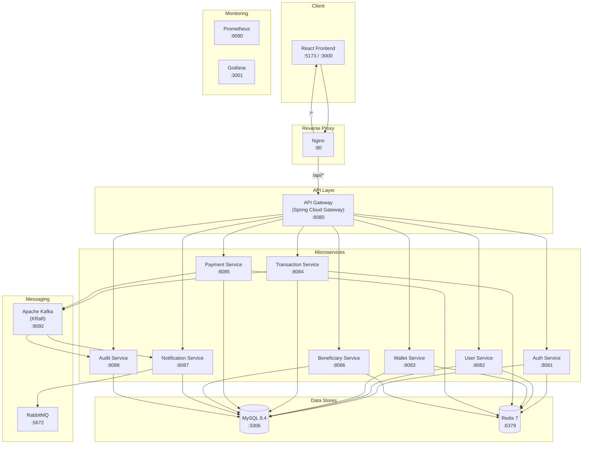

```
 ____                       _   ____
/ ___| _ __ ___   __ _ _ __| |_|  _ \ __ _ _   _
\___ \| '_ ` _ \ / _` | '__| __| |_) / _` | | | |
 ___) | | | | | | (_| | |  | |_|  __/ (_| | |_| |
|____/|_| |_| |_|\__,_|_|   \__|_|   \__,_|\__, |
                                            |___/
```

# SmartPay — Digital Banking & Wallet Management Platform

> A production-grade FinTech microservices platform built with Spring Boot 3.5, React, and a modern event-driven architecture.

[](https://openjdk.org/)
[](https://spring.io/projects/spring-boot)
[](https://react.dev/)
[](LICENSE)

---

## Table of Contents

- [Overview](#overview)
- [Architecture](#architecture)
- [Technology Stack](#technology-stack)
- [Repository Structure](#repository-structure)
- [Prerequisites](#prerequisites)
- [Quick Start](#quick-start)
- [Service Ports](#service-ports)
- [Environment Configuration](#environment-configuration)
- [Development Commands](#development-commands)
- [Testing](#testing)
- [API Documentation](#api-documentation)
- [Monitoring & Observability](#monitoring--observability)
- [Troubleshooting](#troubleshooting)
- [Contributing](#contributing)
- [License](#license)

---

## Overview

SmartPay is a full-featured digital banking and wallet management platform designed around a **microservices architecture**. It supports:

- **Multi-wallet management** — create and manage multiple wallets per user
- **Peer-to-peer transfers** — real-time fund transfers between wallets
- **Payment processing** — track and manage payment lifecycle
- **Beneficiary management** — save and manage transfer recipients
- **Real-time notifications** — event-driven email and push notifications
- **Comprehensive audit trail** — immutable logging of every financial operation
- **Double-entry bookkeeping** — GAAP-compliant financial ledger

---

## Architecture

SmartPay follows a **microservices architecture** with an API Gateway pattern, event-driven communication, and database-per-service isolation.



> For detailed architecture documentation, see [docs/ARCHITECTURE.md](docs/ARCHITECTURE.md).

---

## Technology Stack

| Layer | Technology | Version |
|-------|-----------|---------|
| **Frontend** | React, TypeScript, Vite, Tailwind CSS | React 18, Vite 5+ |
| **Backend** | Java, Spring Boot, Spring Cloud Gateway | Java 21, Spring Boot 3.5.3 |
| **Database** | MySQL | 8.4 |
| **Cache** | Redis | 7 (Alpine) |
| **Messaging** | Apache Kafka (KRaft), RabbitMQ | Kafka 7.9.0, RabbitMQ 3 |
| **API Docs** | SpringDoc OpenAPI (Swagger UI) | 2.8.4 |
| **ORM** | Spring Data JPA, Hibernate | — |
| **Migrations** | Flyway | 11.5.0 |
| **Mapping** | MapStruct | 1.6.3 |
| **Security** | Spring Security, JJWT | JJWT 0.12.6 |
| **Build** | Maven (multi-module), npm | Maven 3.8+, npm 10+ |
| **Observability** | Micrometer, Prometheus, Grafana | Micrometer 1.14.5 |
| **Reverse Proxy** | Nginx | Alpine |
| **Containerization** | Docker, Docker Compose | — |

---

## Repository Structure

```
smartpay-wallet/
├── backend/                          # Java microservices (Maven multi-module)
│   ├── pom.xml                       # Parent POM
│   ├── api-gateway/                  # Spring Cloud Gateway (:8080)
│   ├── auth-service/                 # Authentication & JWT (:8081)
│   ├── user-service/                 # User profile management (:8082)
│   ├── wallet-service/               # Wallet CRUD & balance (:8083)
│   ├── transaction-service/          # Fund transfers & ledger (:8084)
│   ├── payment-service/              # Payment processing (:8085)
│   ├── beneficiary-service/          # Beneficiary management (:8086)
│   ├── notification-service/         # Email & push notifications (:8087)
│   └── audit-service/               # Audit trail & compliance (:8088)
├── frontend/                         # React + TypeScript + Vite
├── infrastructure/
│   ├── kafka/init-topics.sh          # Kafka topic bootstrap
│   ├── mysql/init/                   # DB & user creation SQL
│   ├── nginx/                        # Reverse proxy config
│   ├── rabbitmq/                     # Exchange/queue definitions
│   ├── redis/redis.conf              # Redis configuration
│   └── monitoring/
│       ├── prometheus/prometheus.yml  # Scrape configs
│       └── grafana/                  # Dashboards & provisioning
├── scripts/
│   ├── health-check.sh               # Service health checker
│   └── wait-for-it.sh                # Docker entrypoint helper
├── docs/                             # Project documentation
├── docker-compose.yml                # Full-stack orchestration
├── Makefile                          # Development commands
├── .env.example                      # Environment template
├── .editorconfig                     # Editor settings
└── .gitignore                        # Git ignore rules
```

---

## Prerequisites

| Tool | Minimum Version | Purpose |
|------|----------------|---------|
| **Docker** & **Docker Compose** | Docker 24+, Compose v2 | Infrastructure & containerized services |
| **Java (JDK)** | 21+ | Backend microservices |
| **Maven** | 3.8+ | Java build tool |
| **Node.js** | 20+ | Frontend build toolchain |
| **npm** | 10+ | Frontend package manager |

---

## Quick Start

### 1. Clone & configure

```bash
git clone <repository-url> smartpay-wallet
cd smartpay-wallet
cp .env.example .env
# Edit .env with your secrets (or keep defaults for local dev)
```

### 2. Start infrastructure

```bash
make infra-up
```

This launches MySQL, Redis, Kafka (KRaft), RabbitMQ, Nginx, Prometheus, and Grafana.

### 3. Build & run backend

```bash
make backend-build
```

This compiles all 9 Spring Boot services via the Maven multi-module build.

### 4. Install & run frontend

```bash
make frontend-install
make frontend-dev
```

The frontend dev server starts on **http://localhost:5173** (Vite HMR). The production build is served via Nginx on **http://localhost:3000**.

### 5. Verify

```bash
make health-check
```

Open **http://localhost** (Nginx) to access the application.

---

## Service Ports

| Service | Port | Health Check |
|---------|------|-------------|
| **Frontend (Vite dev)** | `5173` | — |
| **Frontend (production)** | `3000` | — |
| **Nginx** | `80` / `443` | `/nginx-health` |
| **API Gateway** | `8080` | `/actuator/health` |
| **Auth Service** | `8081` | `/actuator/health` |
| **User Service** | `8082` | `/actuator/health` |
| **Wallet Service** | `8083` | `/actuator/health` |
| **Transaction Service** | `8084` | `/actuator/health` |
| **Payment Service** | `8085` | `/actuator/health` |
| **Beneficiary Service** | `8086` | `/actuator/health` |
| **Notification Service** | `8087` | `/actuator/health` |
| **Audit Service** | `8088` | `/actuator/health` |
| **MySQL** | `3306` | — |
| **Redis** | `6379` | — |
| **Kafka** | `9092` | — |
| **RabbitMQ (AMQP)** | `5672` | — |
| **RabbitMQ (Management)** | `15672` | — |
| **Prometheus** | `9090` | — |
| **Grafana** | `3001` | — |

---

## Environment Configuration

All environment variables are documented in [`.env.example`](.env.example). Key groups:

| Group | Variables | Description |
|-------|----------|-------------|
| **MySQL** | `MYSQL_ROOT_PASSWORD`, `*_DB_NAME`, `*_DB_USER`, `*_DB_PASSWORD` | Root credentials & per-service database credentials |
| **Redis** | `REDIS_HOST`, `REDIS_PORT`, `REDIS_PASSWORD` | Cache connection |
| **Kafka** | `KAFKA_BOOTSTRAP_SERVERS`, `KAFKA_CLUSTER_ID` | KRaft broker config |
| **RabbitMQ** | `RABBITMQ_HOST`, `RABBITMQ_PORT`, `RABBITMQ_DEFAULT_USER/PASS` | Message broker |
| **JWT** | `JWT_SECRET`, `JWT_EXPIRATION_MS`, `JWT_REFRESH_EXPIRATION_MS` | Token signing & TTL |
| **Ports** | `GATEWAY_PORT` through `AUDIT_SERVICE_PORT` | Service port bindings |
| **Monitoring** | `PROMETHEUS_PORT`, `GRAFANA_PORT`, `GRAFANA_ADMIN_*` | Observability stack |

> **Security note:** Never commit your `.env` file. The `.gitignore` excludes it by default.

---

## Development Commands

All commands are defined in the [`Makefile`](Makefile):

```bash
# Infrastructure
make infra-up           # Start all infrastructure containers
make infra-down         # Stop and remove infrastructure containers

# Backend
make backend-build      # Maven build all backend services
make backend-test       # Run all backend unit tests

# Frontend
make frontend-install   # npm install
make frontend-dev       # Start Vite dev server (:5173)
make frontend-build     # Production build
make frontend-test      # Run frontend tests

# Full Stack
make full-build         # Build everything (backend + frontend)

# Operations
make health-check       # Check health of all services
make logs               # Tail Docker Compose logs
make clean              # Remove build artifacts
```

---

## Testing

### Backend Tests

```bash
# Run all tests
make backend-test

# Run tests for a specific service
cd backend/wallet-service && mvn test

# Run with coverage report (JaCoCo)
cd backend && mvn verify
# Reports at: backend/<service>/target/site/jacoco/index.html
```

### Frontend Tests

```bash
make frontend-test
```

---

## API Documentation

The API is exposed through the **API Gateway** at `http://localhost:8080/api/v1`.

| Domain | Base Path | Documentation |
|--------|----------|---------------|
| Authentication | `/api/v1/auth/*` | Register, login, logout, refresh tokens |
| Users | `/api/v1/users/*` | Profile management |
| Wallets | `/api/v1/wallets/*` | Wallet CRUD & balance |
| Transactions | `/api/v1/transactions/*` | Fund transfers & history |
| Payments | `/api/v1/payments/*` | Payment lifecycle |
| Beneficiaries | `/api/v1/beneficiaries/*` | Saved recipients |
| Notifications | `/api/v1/notifications/*` | User notifications |
| Admin | `/api/v1/admin/*` | User & audit administration |

> **Full API reference:** [docs/API-DOCUMENTATION.md](docs/API-DOCUMENTATION.md)
>
> **Swagger UI** (per-service): `http://localhost:<port>/swagger-ui.html`

---

## Monitoring & Observability

| Tool | URL | Credentials |
|------|-----|------------|
| **Prometheus** | [http://localhost:9090](http://localhost:9090) | — |
| **Grafana** | [http://localhost:3001](http://localhost:3001) | `admin` / (see `.env`) |
| **RabbitMQ Management** | [http://localhost:15672](http://localhost:15672) | `smartpay` / (see `.env`) |

All backend services expose Prometheus metrics via Spring Boot Actuator at `/actuator/prometheus`. Grafana is pre-configured with Prometheus as a data source and ships with a SmartPay Overview dashboard.

---

## Troubleshooting

### Services won't start

```bash
# Check Docker containers
docker compose ps
docker compose logs <service-name>

# Verify infrastructure health
make health-check
```

### MySQL connection refused

- Ensure MySQL container is healthy: `docker compose ps mysql`
- Wait for initialization to complete (~30 seconds on first run)
- Verify credentials in `.env` match `docker-compose.yml`

### Kafka consumer lag

```bash
# Check consumer group offsets
docker compose exec kafka kafka-consumer-groups \
  --bootstrap-server localhost:29092 \
  --describe --group <group-id>
```

### Port conflicts

If a port is already in use, update the corresponding `*_PORT` variable in `.env` and restart.

### Frontend can't reach API

- Confirm the API Gateway is running on `:8080`
- Ensure Nginx is proxying `/api/*` correctly
- Check CORS headers in browser DevTools

### Build failures

```bash
# Clean and rebuild
make clean
make full-build

# Verify Java version
java -version   # Should be 21+
mvn -version    # Should be 3.8+
```

---

## Contributing

1. **Fork** the repository
2. **Create** a feature branch: `git checkout -b feature/my-feature`
3. **Commit** with conventional commits: `git commit -m "feat(wallet): add currency conversion"`
4. **Push** to your fork: `git push origin feature/my-feature`
5. **Open** a Pull Request against `main`

### Conventions

- **Java:** Follow [Google Java Style Guide](https://google.github.io/styleguide/javaguide.html)
- **Commits:** Use [Conventional Commits](https://www.conventionalcommits.org/) (`feat`, `fix`, `docs`, `chore`, etc.)
- **Branches:** `feature/*`, `fix/*`, `docs/*`, `chore/*`
- **PRs:** Must pass CI checks and have at least one review

---

## Documentation

| Document | Description |
|----------|-------------|
| [Architecture](docs/ARCHITECTURE.md) | System design, C4 diagrams, communication patterns |
| [Database](docs/DATABASE.md) | Schema design, ER diagrams, migration strategy |
| [API Reference](docs/API-DOCUMENTATION.md) | Full REST API documentation with examples |
| [Security](docs/SECURITY.md) | Authentication, authorization, security best practices |
| [Infrastructure](docs/INFRASTRUCTURE.md) | Docker Compose, networking, monitoring setup |
| [Local Development](docs/LOCAL-DEVELOPMENT.md) | Developer setup guide |
| [Deployment](docs/DEPLOYMENT.md) | Production deployment guide |
| [Architecture Decisions](docs/ARCHITECTURE-DECISIONS.md) | ADRs for key design choices |

---

## License

This project is licensed under the **MIT License**. See the [LICENSE](LICENSE) file for details.

---

<p align="center">
  Built with ❤️ by the SmartPay Team
</p>
