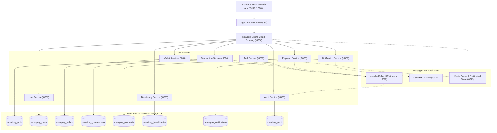

# SmartPay Architecture Specification

## 1. Executive Summary

SmartPay is an enterprise FinTech Digital Banking and Wallet Management platform designed around the core principles of **financial correctness, double-entry ledger invariants, cryptographic idempotency, event-driven decoupling, and zero-trust security**.

The platform is structured as a decoupled microservices architecture utilizing Spring Boot 3.5, Java 21 LTS, React 19, MySQL 8.4, Redis, Apache Kafka (KRaft mode), RabbitMQ, and Spring Cloud Gateway.

---

## 2. High-Level System Architecture

---

## 3. Microservice Boundaries & Responsibilities

| Service | Port | Primary Responsibility | Data Store | Event Channels |
| :--- | :--- | :--- | :--- | :--- |
| **API Gateway** | 8080 | Single entry point, routing, SSL termination, CORS, correlation tracing | Redis (Rate Limiting) | - |
| **Auth Service** | 8081 | Authentication, user credential hashing, JWT token issuance, refresh rotation | `smartpay_auth` | `smartpay.user.events` |
| **User Service** | 8082 | Profile lifecycle, KYC data, user status, customer attributes | `smartpay_users` | `smartpay.user.events` |
| **Wallet Service** | 8083 | Multi-currency digital wallets, double-entry ledger entries, atomic balance projections | `smartpay_wallets` | `smartpay.wallet.events` |
| **Transaction Service** | 8084 | Money transfer lifecycle, cryptographic idempotency enforcement, outbox pattern | `smartpay_transactions` | `smartpay.transaction.events` |
| **Payment Service** | 8085 | Bill pay, merchant checkout, simulated external payment clearing | `smartpay_payments` | `smartpay.payment.events` |
| **Beneficiary Service** | 8086 | Saved payees, account verification, bank code routing directories | `smartpay_beneficiaries` | - |
| **Notification Service** | 8087 | Asynchronous email, SMS, push alerts via durable RabbitMQ queues | `smartpay_notifications` | RabbitMQ topic exchange |
| **Audit Service** | 8088 | Immutable compliance log, actor tracking, security event timeline (INSERT-only) | `smartpay_audit` | Consumes all Kafka topics |

---

## 4. Financial Correctness Principles

1. **Double-Entry Bookkeeping:** All money movements must produce equal debit and credit ledger entries:
   $$\sum \text{Debits} = \sum \text{Credits}$$
2. **Immutable Ledger:** Ledger entries (`wallet_ledger_entries`) are strictly append-only. No records are updated or deleted. Corrections are handled exclusively through compensating journal entries.
3. **Pessimistic Concurrency:** Balance adjustments utilize `SELECT ... FOR UPDATE` row locks inside Spring `@Transactional` blocks to prevent race conditions during concurrent transfers.
4. **No Floats/Doubles:** All monetary amounts are stored and computed using `java.math.BigDecimal` with `DECIMAL(19,4)` precision.
5. **Transactional Outbox:** State changes and event notifications are committed in the same database transaction before publication to Kafka, preventing split-brain states.
