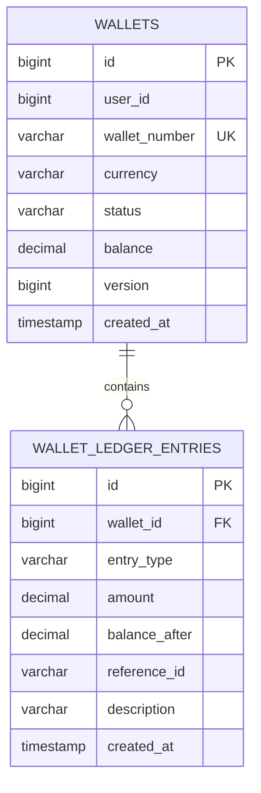

# SmartPay Database Architecture & Schema Specification

## 1. Architecture Overview

SmartPay adheres strictly to the **Database-per-Service** design pattern. Direct cross-database joins and shared tables are strictly prohibited across microservice boundaries.

Each microservice owns a dedicated logical database hosted on MySQL 8.4 LTS, with isolated database credentials following the principle of least privilege. Database evolution is managed using version-controlled Flyway migrations located in `src/main/resources/db/migration/`.

---

## 2. Service Schemas

### 2.1 Auth Service (`smartpay_auth`)
- `users`: Stores core credentials, password hashes (BCrypt), role enums, and account statuses.
- `refresh_tokens`: Stores cryptographically secure refresh tokens with expiry and revocation status.

### 2.2 User Service (`smartpay_users`)
- `user_profiles`: Manages user demographics, addresses, phone numbers, and birth dates.

### 2.3 Wallet Service (`smartpay_wallets`)
- `wallets`: Stores user wallet headers, currencies (USD, EUR, GBP, INR), statuses, and current balance projections.
- `wallet_ledger_entries`: **Immutable journal**. Every credit and debit creates an append-only entry recording `entry_type`, `amount`, `balance_after`, `reference_id`, and timestamp.

### 2.4 Transaction Service (`smartpay_transactions`)
- `transactions`: Records financial movements with a unique `idempotency_key` constraint to ensure strict once-only execution.
- `outbox_events`: Stores domain events awaiting guaranteed delivery to Kafka brokers.

### 2.5 Payment Service (`smartpay_payments`)
- `payments`: Tracks merchant and bill payment transactions, providers, and settlement status.

### 2.6 Beneficiary Service (`smartpay_beneficiaries`)
- `beneficiaries`: Stores saved payout destinations with account numbers, routing codes, and verification tags.

### 2.7 Notification Service (`smartpay_notifications`)
- `notifications`: Records notification dispatches across email, in-app, SMS, and push channels.

### 2.8 Audit Service (`smartpay_audit`)
- `audit_events`: **INSERT-only table** recording actor, action, resource, IP address, correlation ID, and JSON payload. Database user has no `UPDATE` or `DELETE` grants.
