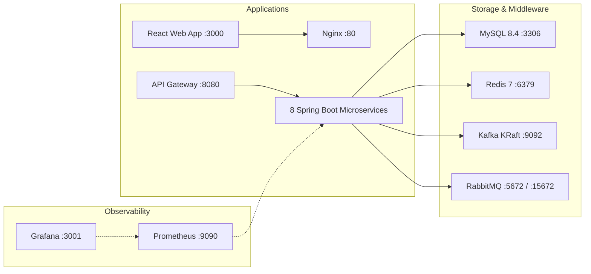

# SmartPay Infrastructure Specification

## 1. Docker Compose Topography

The environment is orchestrated using `docker-compose.yml` on a dedicated bridge network `smartpay-network`.

## 2. Infrastructure Component Details

- **MySQL 8.4 LTS:** Auto-initializes 8 distinct databases and service users via scripts in `infrastructure/mysql/init/`. Persistent volume: `mysql_data`.
- **Redis 7 (Alpine):** In-memory cache with password authentication and LRU eviction policy. Persistent volume: `redis_data`.
- **Apache Kafka 7.9 (KRaft mode):** Runs in modern quorum mode without ZooKeeper dependency. Auto-provisions topics via `infrastructure/kafka/init-topics.sh`. Persistent volume: `kafka_data`.
- **RabbitMQ 3 Management (Alpine):** Pre-configures durable topic exchanges and dead-letter queues through `definitions.json`. UI exposed on `:15672`. Persistent volume: `rabbitmq_data`.
- **Prometheus & Grafana:** Scrapes Spring Boot Actuator `/actuator/prometheus` metrics across all 9 services. Pre-configured dashboard for JVM, request latency, and memory utilization.
