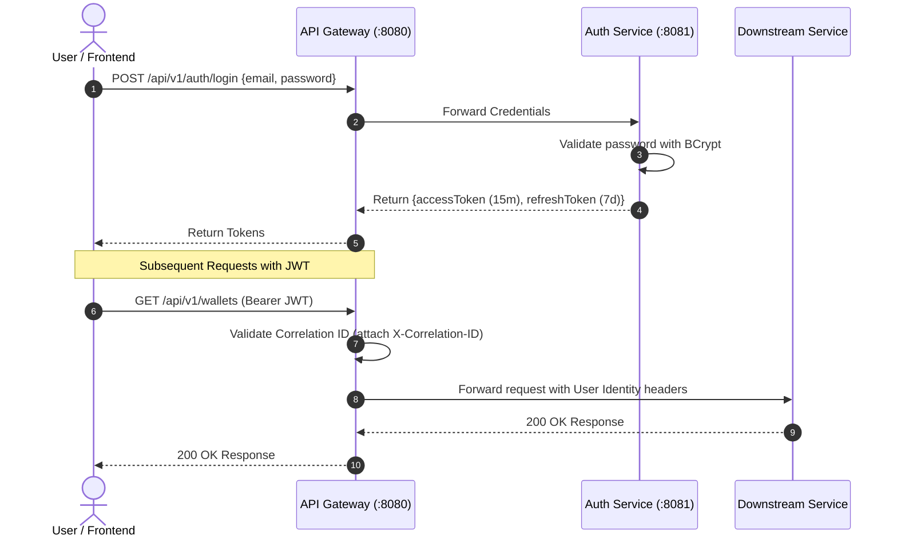

# SmartPay Security Architecture

## 1. Authentication & Token Architecture

## 2. Security Defense-in-Depth

1. **Stateless JWT:** Signed using HMAC-SHA256 (`jjwt` 0.12.6) with short expiration times (15 minutes).
2. **Refresh Token Rotation:** Refresh tokens are single-use. Once redeemed, the existing token is immediately revoked and a new pair is issued.
3. **Password Security:** Hashes are generated via BCrypt with standard cost factor 10. Raw passwords are never persisted or logged.
4. **Correlation & Request Tracing:** The API Gateway inspects and attaches a unique `X-Correlation-ID` (UUID) to every incoming request.
5. **Least-Privilege Database Access:** Service users only have permissions on their respective database. The audit user is granted `SELECT` and `INSERT` only (no `UPDATE` or `DELETE`).
6. **Input Sanitization:** Strict Zod schema validation on the frontend and Spring `@Valid` with JSR-380 annotations on all backend DTOs.
